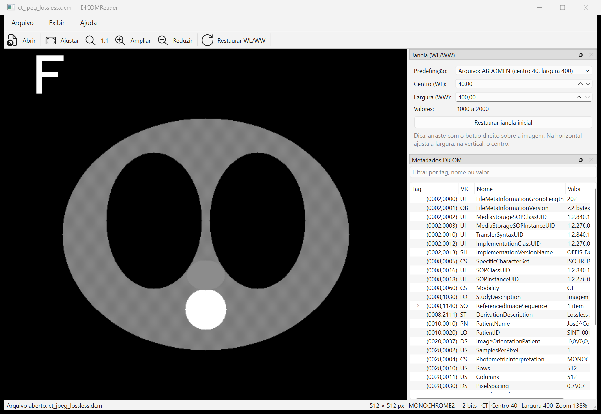

# DICOMReader

Visualizador de imagens DICOM em C++17, com interface em Qt 6 (Qt Widgets) e
leitura/renderização feitas pela [DCMTK](https://dicom.offis.de/dcmtk).



## Descrição da solução

### Escopo obrigatório

- **Seleção do arquivo** pela janela de seleção de arquivos (*Arquivo > Abrir...*, `Ctrl+O`).
  O filtro inclui `*.dcm`, `*.dicom`, `*.dic` e "Todos os arquivos", já que muitos
  arquivos DICOM não têm extensão.
- **Carregamento** com validação do arquivo antes de qualquer processamento.
- **Exibição correta da imagem**:
  - *dimensões*: linhas e colunas do arquivo, com correção para pixels não
    quadrados (Pixel Spacing, Imager Pixel Spacing ou Pixel Aspect Ratio);
  - *escala de cinza*: transformação de modalidade (Rescale Slope/Intercept, ex.:
    Hounsfield em CT), janela VOI do arquivo (Window Center/Width ou VOI LUT),
    MONOCHROME1 exibido invertido, pixels com e sem sinal, de 8 a 16 bits;
  - *orientação*: a primeira linha do arquivo fica no topo e a primeira coluna à
    esquerda, sem espelhamento nem rotação.
- **Mensagens de erro** (diálogo e barra de status) para arquivo inexistente,
  sem permissão de leitura, que não é DICOM ou está corrompido, DICOM sem imagem
  (ex.: DICOMDIR, relatório estruturado), compressão não suportada e atributos de
  imagem ausentes ou inválidos. A imagem que estava aberta continua na tela.

### Diferenciais

- **Window Level / Window Width**: janelas gravadas no arquivo e automáticas
  (mín–máx e por histograma), edição de centro e largura, ajuste arrastando com o
  botão direito sobre a imagem (horizontal = largura, vertical = centro) e
  *Restaurar janela* (`Ctrl+R`).
- **Metadados DICOM**: todos os atributos do cabeçalho e do dataset em árvore
  (sequências aninhadas), com filtro por tag, VR, nome ou valor e cópia (`Ctrl+C`).
  Os textos são convertidos conforme o Specific Character Set (ex.: acentos em
  ISO_IR 100).
- **Imagens coloridas**: RGB, YBR_FULL, YBR_FULL_422 e PALETTE COLOR, convertidas
  para RGB pela DCMTK.

### Extras

- Imagens comprimidas em JPEG (baseline, estendido, progressivo e sem perdas),
  JPEG-LS e RLE.
- Imagens multi-frame, com seletor de frame na barra de ferramentas.
- Zoom (roda do mouse, `Ctrl++`, `Ctrl+-`), pan (arrastar com o botão esquerdo),
  ajustar à janela (`Ctrl+0` ou duplo clique) e tamanho real (`Ctrl+1`).
- Abertura arrastando o arquivo para a janela ou passando o caminho na linha de comando.
- Caminhos com acentos no Windows.

### Arquitetura

O código fica em três partes: um núcleo DICOM sem dependência de Qt Widgets, a
interface e os testes.

```
DICOMReader/                  projeto CMake (é este CMakeLists.txt que se abre no Qt Creator)
├── CMakeLists.txt
├── cmake/
│   ├── dcmtk.cmake           baixa e compila a DCMTK (FetchContent) ou usa uma já instalada
│   └── compilerwarnings.cmake
├── src/
│   ├── main.cpp
│   ├── core/                 biblioteca dicomcore: Qt Core/Gui + DCMTK
│   │   ├── dicomloader         abre, valida e descomprime; devolve o documento ou um LoadError
│   │   ├── dicomimagedocument  imagem pronta para exibição: janelas VOI e renderização dos frames
│   │   ├── dicommetadata       extração dos atributos para exibição
│   │   └── loaderror           códigos e mensagens de erro
│   └── ui/                   biblioteca dicomui: Qt Widgets
│       ├── mainwindow          menus, painéis, barra de status e abertura de arquivos
│       ├── imageview           QGraphicsView: zoom, pan, proporção do pixel, arraste de WL/WW
│       ├── windowlevelpanel    controles de WL/WW
│       └── metadatapanel       árvore de metadados com filtro
└── tests/
    ├── tst_dicomcore.cpp     testes do núcleo
    ├── tst_ui.cpp            testes da interface
    └── dicomtestfiles        gera os arquivos DICOM usados nos testes
```

- **Isolamento da DCMTK**: os tipos da DCMTK ficam escondidos atrás de um *pimpl*
  (`dicomimagedocument_p.h`). A interface não inclui nenhum header da DCMTK.
- **Carregamento** (`DicomLoader::load`):
  1. verifica o caminho (existe, é arquivo, pode ser lido);
  2. lê com `DcmFileFormat::loadFile`, usando a API de caminhos em UTF-16 no Windows;
  3. confirma que é DICOM: cabeçalho Part 10 ou, sem cabeçalho, atributos de
     imagem/SOP no dataset;
  4. confirma que há Pixel Data;
  5. extrai os metadados, convertidos para UTF-8;
  6. descomprime a imagem com os decodificadores JPEG, JPEG-LS e RLE registrados;
  7. cria a `DicomImage`, confere o status e aplica a janela inicial (a primeira
     do arquivo ou, na falta dela, mín–máx).

  Nenhuma exceção chega à interface: todo erro vira um `LoadError` com mensagem
  em português e o detalhe técnico.
- **Renderização**: `DicomImage::getOutputData(8)` aplica todo o pipeline de tons
  de cinza da DCMTK. O buffer vira uma `QImage` (`Grayscale8` ou `RGB888`) com
  *stride* explícito e é copiado, o que evita distorção em larguras que não são
  múltiplas de 4.
- **Proporção do pixel**: é aplicada como transformação de exibição no
  `QGraphicsPixmapItem`, sem alterar os dados da imagem.

## Bibliotecas utilizadas

| Biblioteca | Versão | Uso |
|---|---|---|
| [Qt](https://www.qt.io) | 6.12.0 | Qt Widgets (interface), Qt Gui (`QImage`) e Qt Test (testes) |
| [DCMTK](https://dicom.offis.de/dcmtk) | 3.7.1 | Módulos `dcmdata`, `dcmimgle`, `dcmimage`, `dcmjpeg` e `dcmjpls` (mais `ofstd`, `oflog` e `oficonv`) |

O CMake baixa a DCMTK automaticamente (código-fonte oficial no GitHub, conferido
por hash SHA-256) e a liga estaticamente. Só os módulos usados são compilados, sem
dependências externas: zlib, OpenSSL, libpng, libtiff e ICU ficam desativadas. O
dicionário DICOM e as tabelas de conversão de caracteres ficam embutidos no
executável.

## Versão do Qt

Desenvolvido e testado com o **Qt 6.12.0** (kit *Desktop Qt 6.12.0 MinGW 64-bit*).
O CMake exige o Qt 6.5 ou mais recente.

## Configuração e compilação

### Requisitos

- Qt 6.5 ou mais recente, com os módulos Qt Widgets e Qt Test.
- CMake 3.28 ou mais recente (o que acompanha o Qt Creator serve).
- Compilador C++17. Testado com o MinGW-w64 GCC 13.1 que vem no instalador do
  Qt, no Windows 11.
- Acesso à internet na primeira configuração, para baixar a DCMTK (cerca de 10 MB).
  O primeiro build compila a DCMTK e leva alguns minutos.

### Pelo Qt Creator

1. Abra o arquivo `DICOMReader/CMakeLists.txt`.
2. Selecione o kit *Desktop Qt 6.12.0 MinGW 64-bit*.
3. Compile (`Ctrl+B`) e execute (`Ctrl+R`).

### Pela linha de comando (Windows, PowerShell)

A partir da raiz do repositório, usando as ferramentas que acompanham o Qt:

```powershell
$env:PATH = "C:\Qt\Tools\mingw1310_64\bin;C:\Qt\Tools\CMake_64\bin;C:\Qt\Tools\Ninja;$env:PATH"
cmake -S DICOMReader -B build -G Ninja -DCMAKE_BUILD_TYPE=Release -DCMAKE_PREFIX_PATH=C:/Qt/6.12.0/mingw_64
cmake --build build
```

Ajuste `C:\Qt` caso o Qt esteja instalado em outra pasta.

### Linux e macOS

```bash
cmake -S DICOMReader -B build -G Ninja -DCMAKE_BUILD_TYPE=Release -DCMAKE_PREFIX_PATH=$HOME/Qt/6.12.0/gcc_64
cmake --build build
```

No macOS, use `$HOME/Qt/6.12.0/macos` como `CMAKE_PREFIX_PATH`. O código e o CMake
são portáveis, mas só o Windows foi testado.

### Opções do CMake

| Opção | Padrão | Descrição |
|---|---|---|
| `DICOMREADER_BUILD_TESTS` | `ON` | Compila os testes automatizados. |
| `DICOMREADER_USE_SYSTEM_DCMTK` | `OFF` | Usa uma DCMTK já instalada (`find_package(DCMTK CONFIG)`; informe `DCMTK_DIR` se preciso) em vez de baixá-la. |

## Execução

- **Qt Creator**: `Ctrl+R`.
- **Pasta pronta para executar**: o `install` copia o executável junto com as
  bibliotecas, os plugins e as traduções do Qt (via `windeployqt` no Windows):

  ```powershell
  cmake --install build --prefix dist
  .\dist\bin\DICOMReader.exe
  ```

- **Direto da pasta de build**: `build\DICOMReader.exe`, com `C:\Qt\6.12.0\mingw_64\bin`
  no `PATH` (é o que o Qt Creator faz).
- **Com um arquivo**: `DICOMReader.exe caminho\para\imagem.dcm`.

### Uso

| Ação | Como |
|---|---|
| Abrir arquivo | *Arquivo > Abrir...* (`Ctrl+O`) ou arrastar o arquivo para a janela |
| Zoom | Roda do mouse, `Ctrl++` e `Ctrl+-` |
| Mover a imagem | Arrastar com o botão esquerdo (com zoom) |
| Ajustar à janela / tamanho real | `Ctrl+0` ou duplo clique / `Ctrl+1` |
| Ajustar WL/WW | Arrastar com o botão direito, ou o painel *Janela (WL/WW)* |
| Restaurar a janela inicial | `Ctrl+R` |
| Trocar de frame | Seletor *Frame* na barra de ferramentas (só em multi-frame) |
| Filtrar e copiar metadados | Campo de filtro e `Ctrl+C` no painel *Metadados DICOM* |

## Testes

```powershell
ctest --test-dir build --output-on-failure
```

Os testes não dependem de arquivos externos: cada caso gera os DICOMs de que
precisa com a própria DCMTK.

- **`tst_dicomcore`** (núcleo):
  - orientação e ordem das linhas, largura que não é múltipla de 4;
  - janela do arquivo, janela automática e personalizada, MONOCHROME1,
    Rescale Slope/Intercept, pixels com sinal, proporção do pixel, multi-frame;
  - RGB e YBR_FULL;
  - RLE, JPEG sem perdas e JPEG-LS (comparando com a imagem original);
  - JPEG 2000 rejeitado;
  - erros: arquivo inexistente, pasta, arquivos vazios/texto/binários/PNG,
    DICOM sem imagem, atributos ausentes, arquivo truncado;
  - metadados: sequências e conjunto de caracteres;
  - caminhos com acentos.
- **`tst_ui`** (interface): roda com a plataforma `offscreen` do Qt, sem abrir
  janelas, e cobre o visualizador (ajuste, zoom, proporção, arraste com o botão
  direito), os painéis de WL/WW e de metadados (filtro, cópia) e a janela
  principal (abertura, erro mantendo a imagem anterior, WL/WW por arraste,
  predefinições, frames e imagens coloridas).

## Arquivo DICOM de teste

O arquivo DICOM anônimo fornecido com o enunciado está no
[Google Drive](https://drive.google.com/file/d/1hQXHPRN9xqAlUyUxl3HDvj_O7cEVERKc/view?usp=sharing).
Ele não faz parte do repositório: basta baixá-lo e abri-lo pelo menu *Arquivo > Abrir...*.

## Limitações conhecidas

- **JPEG 2000 (e HTJ2K)**: não é suportado pela DCMTK livre; esses arquivos
  geram a mensagem de compressão não suportada.
- **Deflated Explicit VR Little Endian**: não é suportado, porque a zlib está
  desativada para manter o build sem dependências externas.
- **Float Pixel Data / Double Float Pixel Data**: não é exibido.
- **Não implementados**: Presentation States (GSPS) e marcadores de orientação
  anatômica (A/P/R/L).
- **Arquivos muito grandes**: o carregamento é síncrono e pode travar a
  interface por alguns instantes.

## Licença

[MIT](LICENSE). A DCMTK é distribuída sob a licença BSD da OFFIS.
